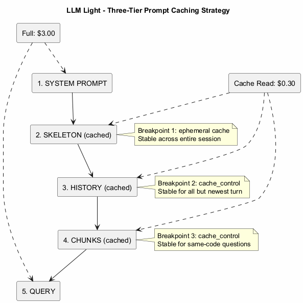
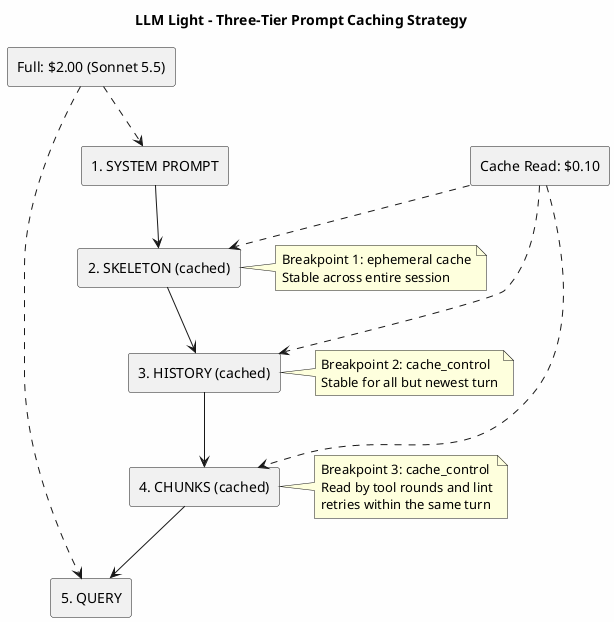

# Three-Tier Caching Strategy

> Part of the [architecture index](ARCHITECTURE.md). Source: the original `docs/architecture.md`, split by topic.

Prompt caching is a Claude capability. Gemini and Codex have none: they get the same skeleton and chunks as text on standard input, `warm_cache()` does nothing for them, and both apply their own server-side prefix caching, which llm_light does not control; their turn stats show the cached tokens they report (agy's `cache_read_tokens`, codex's `cached_input_tokens`), with no dollar figure. The rest of this page is about Claude.

LLM Light uses Anthropic's ephemeral caching with three strategic breakpoints to minimize costs.

### Cache Breakpoints

| Breakpoint | Location | Stable Across | Savings |
|------------|----------|---------------|---------|
| 1 | End of skeleton | Entire session | 90% off skeleton re-reads |
| 2 | End of history | All but newest turn | 90% off conversation history |
| 3 | End of chunks | Tool rounds and lint retries of the same turn | 90% off retrieved context on each extra round |

### On the subscription

An OAuth turn goes through the `claude` CLI, which sets its own breakpoints, so the table above is API-key mode. What llm_light controls there is what the prompt holds. Flattened by `transcript()`, the history is one text block, and no cache boundary falls inside a block, so every turn wrote all of it again. The files the agent read were gone too, since each turn is a new process and the history keeps only the replies.

So turns continue one CLI session (`claude._session_to_resume`): the first turn sends the whole prompt, and later ones `--resume` it with only the new message and `--system-prompt-snapshot off`, without which the CLI resends the first turn's system prompt and a rebuilt skeleton never arrives. Measured live: 25% lower cost per session, 42% fewer cache writes, 63% more cache reads (`docs/BENCHMARKS.md`, section 2h). A pause within the CLI's 1-hour cache entry costs nothing: a resumed turn after 6.5 minutes read 54,154 tokens and wrote 19. Past it a resume writes the whole session again, so a turn more than `CACHE_TTL_SECS` (55 minutes) after the last one starts over instead, on the history llm_light keeps: after 65 minutes a one-word resumed turn wrote 51,583 tokens and cost $0.2066, and on the whole prompt 4,680 and $0.0188. The agent then reads again what it needs.

What makes this safe:

- **The session ends whenever the conversation stops matching it.** `state.cli_session` is set to `None` by `/clear`, `/compact`, `/rewind`, `/undo`, `/resume`, history compression, and a failed or interrupted turn, and a turn on another model or after the cache entry expires starts over. The next turn sends the history as llm_light keeps it. Compression ending it is also what bounds its growth, since the session keeps every file it read.
- **A resumed turn names the files that changed since the last one** (`claude._changed_files_note`, `git_manager.changed_since`). The session remembers what it read, and the CLI says nothing on a `-p` resume. `turn_done()` takes the snapshot after the turn's own edits and commits, so those are not reported. Outside a git repository nothing can tell, so nothing resumes.
- **A resume that fails before showing or doing anything** runs the turn on the whole prompt and stops resuming for the run. One that fails later is not repeated, since it may have edited files.
- **The kept home** (`state.cli_home`) holds the CLI's transcripts for the run. The credentials copy is removed after every call, and the directory at exit. Hidden calls such as the history summary keep their own home and stay out of the session.

`total_cost_usd` is the whole session's on a resume, so `_remember_session` charges a turn the difference. `usage` is per run.

### What the skeleton holds

`skeleton.build_skeleton()` renders the compressed directory tree, then the `.md` files `skeleton._in_prompt()` lets in: `CLAUDE.md` and `AGENTS.md` in full, other docs compacted to about 1,200 characters when long and structured.

Which docs depends on the provider. One whose agent can open files (Claude, the `AGENT` capability) gets only `CLAUDE.md` and `AGENTS.md` at any depth and the root `README`; the tree lists the rest, and the model opens what it needs. Most excerpts are little more than headings and every turn pays for them: on this repo the skeleton goes from 15,952 to 3,564 tokens. Gemini and Codex have no tool to open a file, so they keep every excerpt: without them they lost 7 of 10 doc questions. The measurements are in `docs/BENCHMARKS.md` section 2f (#142). Editing a doc that is left out does not change the prompt, so it costs no cache write.

In a git work tree only the `.md` files `git ls-files` lists go in (`skeleton._tracked_md()`, the index included, so a staged file counts); outside one, all of them. An untracked draft is left out because every turn reads the skeleton and every 1-hour cache write pays twice for it: on this repo two local drafts were 699 of 16,448 skeleton tokens. The tree still names the file, so the model can ask to read it. The file watcher applies the same rule (`_refresh_single_md`), and a file staged later comes in at the next full rebuild.

### Effort and model changes

- **Effort.** A top-level `output_config.effort` change invalidates the history cache, and on some models the skeleton cache too. Requests therefore always send `BASE_EFFORT` at the top level, and the routed effort goes in an effort-only system message after the history breakpoint (`_apply_effort()`, see [routing.md](routing.md)). `warm_cache()` (it calls `ClaudeProvider.warm()` in `providers/claude.py`) sends the same top-level effort, or it would warm an entry no turn reads.
- **Model.** The cache is scoped per model; nothing written on Sonnet is read by Haiku or Opus. `warm_cache()` warms the model the next turn reads: the `--model` or `/model` pin, else `state.session_model`. With neither (before the first routed turn, or with `LLM_LIGHT_ROUTE_ONCE=0`) it sends nothing, because a guess is a 1-hour write that a turn on another model never reads; the first turn writes its own entry. By default the first turn's model is kept for the session (`ROUTE_ONCE`), so a session writes one model's cache only. `LLM_LIGHT_ROUTE_ONCE=0` routes the model per turn. Keeping a session on its strongest model instead cost more in `tests/benchmarks/benchmark_session_cache.py` than the cache writes it saves.

### Pricing (USD per 1M tokens)

Every call is priced at the model that ran it (`MODEL_PRICES` in `config.py`, list prices checked 2026-10-24). The skeleton block uses the 1-hour cache TTL, so its writes cost the 1 h rate; in OAuth mode the cost the Claude CLI reports for the turn is used as is.

| Model | Input | Cache write (5 m) | Cache write (1 h) | Cache read | Output |
|-------|-------|-------------------|-------------------|------------|--------|
| Haiku 5.5 | $0.10 | $0.125 | $0.20 | $0.01 | $0.50 |
| Sonnet 5.5 | $2.00 | $2.50 | $4.00 | $0.10 | $10.00 |
| Opus 5.5 | $4.00 | $5.00 | $8.00 | $0.20 | $20.00 |
| Fable 5.1 | $10.00 | $12.50 | $20.00 | $0.25 | $50.00 |

View PlantUML Source

---

